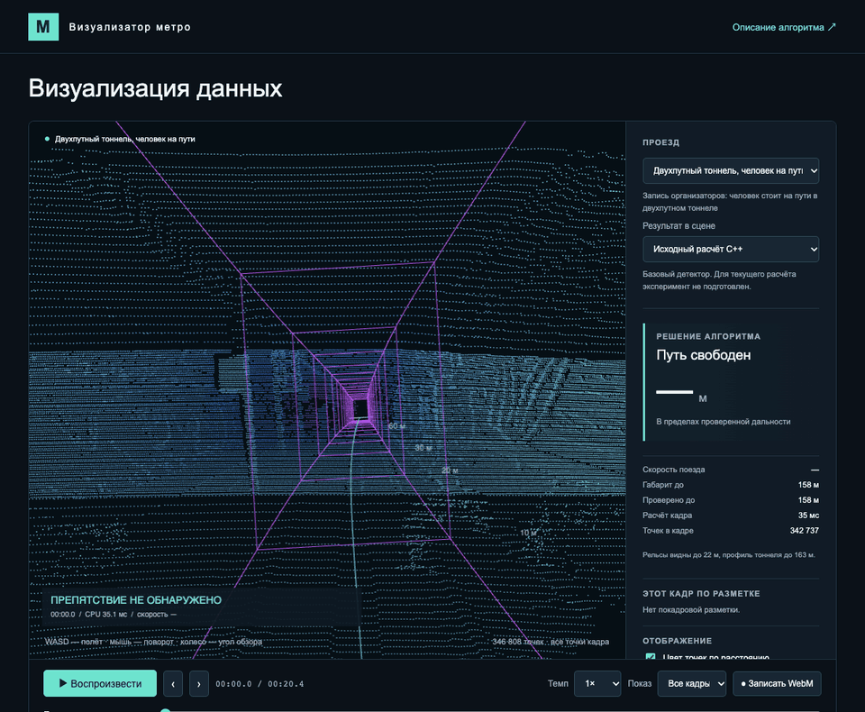

# Детектор препятствий в тоннеле метро

По облаку точек 3D-лидара детектор находит объекты на пути поезда и измеряет расстояние до них. Ядро работает на CPU. Проект включает реализацию на C++17, эталонную версию на Python и ноду для ROS 2 Humble.

Команда **xixi-square** заняла **2-е место** в задаче Московского метрополитена на хакатоне «Лидеры цифровой трансформации» в 2026 году. [Итоговый протокол, стр. 5](https://i.moscow/upload/lending/lct2026/edebdf.pdf#page=5)

## Документация по темам

| Тема | Что почитать |
| --- | --- |
| Геометрия пути | [Как по рельсам и стенам восстановить ось пути](docs/ALGORITHM.md) · [Как проверить проекцию точек на повороте](docs/PROJECTION_AUDIT.md) |
| Решение о препятствии | [Объекты у границы габарита](docs/BOUNDARY_DETECTION.md) · [Подтверждение по нескольким кадрам](docs/SOFT_THREAT.md) |
| Подключение лидара | [Формат облаков и собственных записей](docs/DATASETS.md) · [Запуск, топики и состояния ROS 2](docs/ROS2.md) |
| Эксперименты | [Какие изменения проверяли в детекторе](docs/EXPERIMENTS.md) · [Как добавить синтетическое препятствие в облако](docs/AUGMENTATION.md) |
| Испытания | [Как измеряли дальность, ложные тревоги и время расчёта](docs/BENCHMARK.md) · [Результаты команды](docs/PRESENTATION_STATS.md) |



На 45 м детектор замечает ящик и выделяет его жёлтым. Следующее наблюдение подтверждает препятствие. Ящик становится красным, а рядом с ним обновляется расстояние вдоль пути.

## Как работает детектор

На конкурсных записях было мало примеров препятствий. Поэтому сначала мы восстанавливаем по облаку точек путь и определяем, какое пространство займёт поезд. Так можно искать предметы разной формы без обучения классификатора для каждого типа объекта.

### Рельсы и форма тоннеля

Алгоритм делит облако на поперечные срезы. Рядом с поездом в них различимы головки обоих рельсов. Детектор связывает пары рельсов между соседними срезами и по ним оценивает центр пути, высоту и поперечный наклон колеи.

Примерно после 40 м отражения от рельсов редеют. В повороте радиусом 300 м прямая, проведённая вдоль рельсов, уже через 100 м отклоняется от пути примерно на 16 м. Поэтому детектор запоминает сечение тоннеля вблизи и совмещает его с дальними срезами по стенам. Так он восстанавливает изгиб пути и определяет, до какой дальности ось подтверждается измерениями.

### От точек до препятствия

Вдоль оси детектор строит габарит поезда. Для каждой точки он вычисляет расстояние вдоль пути, смещение вбок и высоту над рельсами. Это позволяет проверять попадание в габарит и на кривом участке. Соседние точки внутри габарита детектор объединяет в группу и отслеживает её как возможное препятствие. Для объекта у края дополнительно учитывается погрешность положения оси.

Между кадрами поезд успевает сместиться. Детектор оценивает сдвиг по профилю стен и сопоставляет кандидатов с предыдущими наблюдениями. Если новые отражения подтверждают объект, в ответ попадает расстояние вдоль пути до ближайшего препятствия.

### Что получает ROS 2

Нода принимает `sensor_msgs/PointCloud2`, а геометрию рассчитывает отдельный процесс. Пока он занят, для следующего расчёта сохраняется самое свежее облако. При остановке входного потока или устаревшем результате нода сообщает, что данных недостаточно.

В топике `/metro/clearance` публикуются состояние пути, подтверждённые и неподтверждённые кандидаты, расстояние до препятствия и проверенная дальность. Последняя показывает, какую часть пути удалось оценить в текущем кадре. Нарисованный в RViz габарит при кратком пропуске измерений может оставаться длиннее.

## Результаты испытаний

| Что измеряли | Результат |
| --- | --- |
| Ложные тревоги на свободном пути | 0 на 13 558 кадрах шести записей (15,4 км), при офлайн-проверке ядра |
| Обнаруженные препятствия на синтетике | Все 15 объектов в четырёх записях вызвали хотя бы одну подтверждённую тревогу |
| Наибольшая дальность обнаружения человека на записи с лидара Seyond Falcon | 273 м в отдельном кадре и до 271 м при подтверждении в пяти кадрах подряд |
| Время расчёта одного кадра ядром на CPU | В среднем 13,9 мс в конкурсном замере при частоте лидара 10 Гц |

Для лидара Pandar128 зона поиска составляет до 300 м. Фактическая дальность обнаружения зависит от видимости и количества отражений от объекта. [Условия испытаний](docs/PRESENTATION_STATS.md) · [Методика измерений](docs/BENCHMARK.md)

На одних и тех же 11 записях сравнили промежуточную и финальную версии. В первой дальний край габарита резко перемещался вперёд и назад как минимум на 10 м в 255 кадрах. В финальной таких кадров было 0. [График устойчивости из презентации ЛЦТ](docs/img/axis-stability-lct.png)

## Попробовать на синтетическом тоннеле

Из корня проекта выполните команды в виртуальном окружении Python 3.10 или новее. Первый скрипт создаст облака точек и прогонит через них детектор. Второй запустит локальный визуализатор.

```bash
python -m pip install -r requirements.txt
python scripts/make_demo.py
python scripts/serve.py
```

Откройте `http://127.0.0.1:8765/viewer/`. В примере лидар приближается к ящику на пути.

## Запустить на своей записи

Понадобятся Docker и запись ROS 2 с топиком `sensor_msgs/PointCloud2`. Передайте папку, в которой лежат каталоги записей с `metadata.yaml` и файлами `.db3`.

```bash
./run.sh /путь/к/записям
```

В Windows запустите `.\run.ps1 D:\bags` из PowerShell. Скрипт откроет RViz в браузере. В терминале контейнера команда `bags` покажет список записей, а `play 1` запустит первую. Нода публикует состояние пути, расстояние до препятствия и дальность, на которую удалось проверить путь. [Формат данных](docs/DATASETS.md) · [Запуск и сообщения ROS 2](docs/ROS2.md)

## Код и тесты

- [core/](core/) и [metro/](metro/) содержат ядро C++ и реализацию на Python. Команда `python -m unittest discover -s tests -p test_tunnel.py` проверяет детектор на синтетическом тоннеле.
- [eval/](eval/) и [scripts/](scripts/) содержат инструменты для оценки на собственных данных, добавления синтетических препятствий и экспорта результатов. [Эксперименты](docs/EXPERIMENTS.md) · [Аугментация облаков точек](docs/AUGMENTATION.md)
- [viewer/](viewer/) отображает облако точек, габарит поезда и решения по каждому кадру. [Проверка геометрии проекции](docs/PROJECTION_AUDIT.md)

## Команда

Илья Михайловский (капитан) отвечал за алгоритм детектора и интеграцию с ROS 2. Игорь Шабаров работал над геометрией пути, данными и визуализацией.
