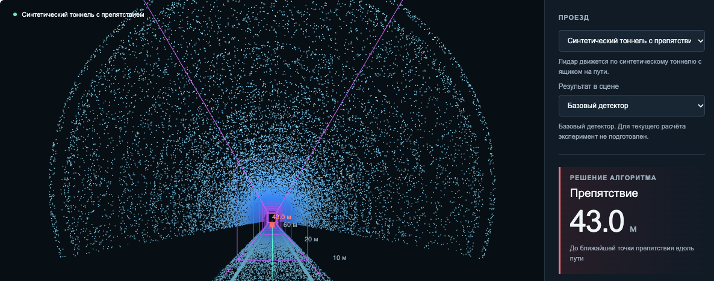

# Детектор препятствий в тоннеле метро

По облаку точек 3D-лидара детектор находит объекты на пути поезда и измеряет расстояние до них. Ядро работает на CPU. Проект включает реализацию на C++17, эталонную версию на Python и ноду для ROS 2 Humble.

Команда **xixi-square** заняла **2-е место** в задаче Московского метрополитена на хакатоне «Лидеры цифровой трансформации» в 2026 году. [Итоговый протокол, стр. 5](https://i.moscow/upload/lending/lct2026/edebdf.pdf#page=5)



## Как работает детектор

Вблизи поезда детектор находит рельсы. Дальше, где их уже трудно различить, он восстанавливает траекторию по форме тоннеля. Вдоль траектории алгоритм строит габарит поезда и ищет точки внутри него с учётом погрешности. По нескольким последовательным кадрам он проверяет, действительно ли перед поездом препятствие. [Геометрия и алгоритм](docs/ALGORITHM.md)

## Результаты испытаний

| Что измеряли | Результат |
| --- | --- |
| Ложные тревоги на свободном пути | 0 на 15,4 км тестовых записей |
| Наибольшая дальность обнаружения человека на записи с лидара Seyond Falcon | 273 м в отдельном кадре и до 271 м при подтверждении в пяти кадрах подряд |
| Время расчёта одного кадра ядром на CPU | 13,9 мс в контрольном замере |

Для лидара Pandar128 зона поиска составляет до 300 м. Фактическая дальность обнаружения зависит от видимости и количества отражений от объекта. [Условия испытаний](docs/PRESENTATION_STATS.md) · [Методика измерений](docs/BENCHMARK.md)

## Попробовать на синтетическом тоннеле

Из корня проекта выполните команды в виртуальном окружении Python 3.10 или новее. Первый скрипт создаст облака точек и прогонит через них детектор. Второй запустит локальный визуализатор.

```bash
python -m pip install -r requirements.txt
python scripts/make_demo.py
python scripts/serve.py
```

Откройте `http://127.0.0.1:8765/viewer/`. В примере лидар приближается к ящику на пути. Кадр 8 показан на снимке выше.

## Запустить на своей записи

Понадобятся Docker и запись ROS 2 с топиком `sensor_msgs/PointCloud2`. Передайте папку, в которой лежат каталоги записей с `metadata.yaml` и файлами `.db3`.

```bash
./run.sh /путь/к/записям
```

В Windows используйте PowerShell: `.\run.ps1 D:\bags`. Скрипт откроет RViz в браузере. В терминале контейнера команда `bags` покажет список записей, а `play 1` запустит первую. Нода публикует состояние пути, расстояние до препятствия и дальность, на которую удалось проверить путь. [Формат данных](docs/DATASETS.md) · [Запуск и сообщения ROS 2](docs/ROS2.md)

## Код и тесты

- [core/](core/) и [metro/](metro/) содержат ядро C++ и реализацию на Python. Команда `python -m unittest discover -s tests -p test_tunnel.py` проверяет детектор на синтетическом тоннеле.
- [eval/](eval/) и [scripts/](scripts/) содержат инструменты для оценки на собственных данных, добавления синтетических препятствий и экспорта результатов. [Эксперименты](docs/EXPERIMENTS.md) · [Аугментация облаков точек](docs/AUGMENTATION.md)
- [viewer/](viewer/) отображает облако точек, габарит поезда и решения по каждому кадру. [Проверка геометрии проекции](docs/PROJECTION_AUDIT.md)

## Команда

Илья Михайловский (капитан) отвечал за алгоритм детектора и интеграцию с ROS 2. Игорь Шабаров работал над геометрией пути, данными и визуализацией.
