# Алгоритм «Профиль тоннеля»

Детектор восстанавливает путь поезда по рельсам и форме тоннеля, затем ищет отражения внутри габарита движения. Входом служит облако точек одного кадра. История помогает оценить движение поезда, сгладить геометрию и подтвердить кандидатов во времени.

## Конвейер

```mermaid
flowchart LR
    A[Облако PointCloud2] --> B[Декодирование и преобразование координат]
    B --> C[Оценка смещения между кадрами]
    C --> D[Рельсы и плоскость пути вблизи]
    D --> E[Шаблон сечения тоннеля]
    E --> F[Продолжение оси вдаль]
    F --> G[Проекция точек в координаты пути]
    G --> H[Кластеры внутри габарита]
    H --> I[Подтверждение по истории]
    I --> J[Состояние пути и расстояние]
```



## Координаты

После преобразования в систему анализа ось `x` направлена вперёд, `y` влево, `z` вверх. При другом расположении лидара задаётся преобразование `source_to_analysis` или выбирается `sensor_axes`.

Ось пути описывают горизонтальная кривая `c(x)` и высота головок рельсов `r(x)`. Наклон плоскости пути поперёк учитывается отдельно. Для проверки габарита используются длина дуги `s`, боковое смещение `u` и высота над плоскостью пути `h`.

Для локально гладкой оси рабочая проекция имеет вид

$$
u = (y-c(x))\cos\theta,\qquad
h = z-r(x)-\varphi u,\qquad
\tan\theta = c'(x).
$$

Здесь `φ` задаёт поперечный наклон. Проверка точности приближения описана в [диагностике проекции](PROJECTION_AUDIT.md).

## Оценка движения

На стенах тоннеля строится профиль глубины. Его неоднородности служат признаками для сопоставления соседних кадров. По сдвигу профиля оценивается продольное перемещение датчика.

Эта оценка переносит предыдущую ось и историю кандидатов в текущую систему. Временные метки учитываются при пропуске кадров. После длительного разрыва история сбрасывается, чтобы старый прогноз не продолжал влиять на новый участок.

## Рельсы в ближней области

Точки делятся на поперечные срезы. В каждом срезе ищутся пары гребней, соответствующих головкам рельсов. Кандидаты из соседних срезов связываются динамическим программированием с ограничением на скачки положения.

По выбранным парам оцениваются центр пути и плоскость головок рельсов. Робастная аппроксимация уменьшает влияние посторонних отражений. Предыдущая ось задаёт начальное приближение, а при неудаче выполняется повторный поиск с нейтральным приором.

Высота установки датчика оценивается из геометрии облака. Точное преобразование можно передать явно, если оно известно из калибровки.

## Сечение тоннеля и дальняя ось

Ближние точки стен переводятся в координаты пути и образуют шаблон поперечного сечения. Шаблон последовательно совмещается с дальними срезами. Для каждого совмещения оцениваются положение, качество опоры и неопределённость.

Из последовательности срезов строится гладкая ось. Модель ограничивает резкие изломы и обратные изгибы. Краткие пробелы геометрии можно перекрывать прогнозом, а существенная смена сечения ограничивает измеренную область.

Последняя измеренная часть оси задаёт направление и кривизну продолжения. Продолжение имеет собственную неопределённость. При сравнении версий качество измеренной оси и качество её экстраполяции оцениваются раздельно.

## Проверка габарита

Габарит задаётся относительно найденной плоскости пути. Положение точки сравнивается с его границами с учётом неопределённости оси. Эта неопределённость растёт с дальностью и недостатком опорных отражений.

Точки внутри области интереса объединяются в кластеры. Для кандидата сохраняются рамка, расстояние вдоль пути, число наблюдений и признаки качества. Повторяющиеся координаты не должны искусственно увеличивать уверенность.

У границы габарита учитываются отдельно геометрическое пересечение и качество наблюдения. [Подробности обработки границ](BOUNDARY_DETECTION.md).

## Подтверждение во времени

Кандидаты сопоставляются между кадрами после компенсации движения поезда. Новые наблюдения увеличивают уверенность, отсутствие поддержки уменьшает её. Удержанная из прошлого кадра рамка не считается новым измерением.

Для компактных далёких кандидатов и для объектов рядом с границей есть дополнительные способы накопления свидетельств. Они используют свежие отражения и согласованное положение объекта. [Критерии подтверждения](SOFT_THREAT.md).

Подтверждённые кандидаты могут временно сохраняться при кратком ухудшении видимости. При оценке качества отдельно учитываются фактически измеренные и удержанные рамки.

## Выход

| Поле | Значение |
| --- | --- |
| `status` | `unknown`, `clear`, `candidate` или `obstacle` |
| `obstacle` | Есть ли подтверждённое препятствие |
| `distance_m` | Расстояние вдоль оси до ближайшего препятствия, если определено |
| `analysis_range_m` | Дальность анализа текущего кадра |
| `envelope_range_m` | Длина габарита, показанного в визуализации |
| `candidates` | Кандидаты с геометрией и признаками подтверждения |

Точный набор JSON-полей определяется реализацией. Типизированный интерфейс ROS описан в [ROS2.md](ROS2.md).

Нарисованный габарит может сохранять длину при кратком провале дальних измерений. Решения при этом ограничиваются текущей дальностью анализа. Поэтому `envelope_range_m` и `analysis_range_m` различаются по смыслу.

## Реализация

- `core/` содержит вычислительное ядро на C++17, C API и декодирование облаков.
- `metro/native.py` подключает C API через `ctypes`.
- `metro/tunnel.py` содержит эталонную реализацию на Python.
- `metro/pipeline.py` объединяет декодирование, выбор системы координат и запуск детектора.
- `metro/runtime.py` и `metro/ros_node.py` выполняют расчёт отдельно от приёма данных и публикуют результат.

Сборка ядра из корня проекта

```bash
cmake -S core -B core/build -DCMAKE_BUILD_TYPE=Release
cmake --build core/build --parallel
ctest --test-dir core/build --output-on-failure
```

Python-обвязка ищет библиотеку в `core/build/`, установке ROS и по переменным `METRO_CORE_LIB` и `METRO_CORE_LIB_LONG`.

## Проверка

На синтетических сценах проверяются прямая и кривая ось, пустой путь, препятствия, повторные точки, изменение временных меток и разрывы последовательности. При оценке на собственных записях стоит дополнительно проверять повороты, изменения формы тоннеля, платформы и участки с редкими отражениями. [Методика испытаний](BENCHMARK.md).
