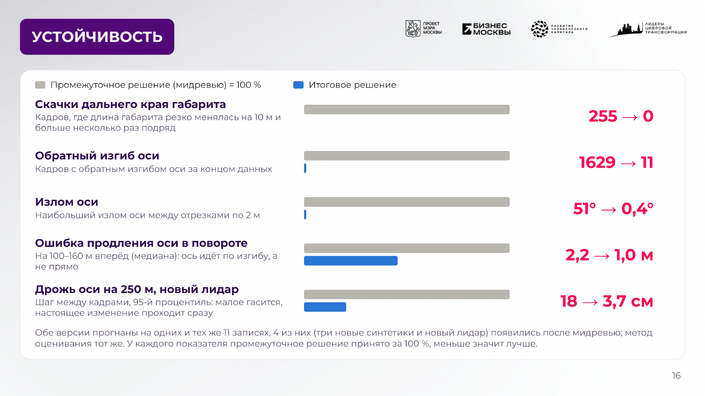

# Результаты проекта

Команда xixi-square заняла 2-е место в задаче Московского метрополитена на хакатоне «Лидеры цифровой трансформации 2026». [Официальный протокол, страница 5](https://i.moscow/upload/lending/lct2026/edebdf.pdf#page=5)

| Проверка | Результат |
| --- | --- |
| Свободный путь, офлайн-прогон | 0 ложных тревог на 13 558 кадрах шести записей общей длиной 15,4 км |
| Препятствия на синтетике | 15 из 15 объектов в четырёх записях вызвали хотя бы одну подтверждённую тревогу |
| Человек на тестовой записи | До 273 м в отдельном кадре |
| Подтверждение человека по серии кадров | До 271 м в пяти кадрах подряд |
| Зона поиска для Pandar128 | До 300 м |
| Расчёт кадра ядром на CPU | В среднем 13,9 мс в конкурсном замере команды |

Лидар выдавал кадр каждые 100 мс. В конкурсном замере медиана расчёта ядра по отдельным записям составляла от 11 до 18 мс, а 95-й процентиль на каждой записи укладывался в 21 мс. В эти значения входит только расчёт кадра. Полную задержку от приёма облака до публикации ответа в ROS измеряют отдельно.

## Устойчивость траектории

Команда прогнала промежуточную и финальную версии на одних и тех же 11 записях. Число кадров, где дальний край габарита скакнул как минимум на 10 м и сразу вернулся, снизилось с 255 до 0. За пределами видимого участка ось изгибалась в обратную сторону в 11 кадрах вместо 1 629.

## Границы испытаний

Дальность поиска задаёт область работы алгоритма. Фактическая дальность обнаружения зависит от плотности отражений, геометрии тоннеля и прямой видимости. Результаты относятся к проверенным записям и не заменяют испытания на новом маршруте и оборудовании.

Индивидуальные координаты объектов, покадровая разметка и исходные записи в публичную версию не входят. [Методика измерений](BENCHMARK.md).
